<!-- This file is auto-generated. if you do not want it to be overwritten, set TRUE in the line below -->
<!-- DO_NOT_OVERWRITE_DOC=FALSE -->

# Installation Close Check

## Flow Diagram [(_View History_)](Installation_Close_Check-history.md)

<!-- Flow description -->

## General Information

|<!-- -->|<!-- -->|
|:---|:---|
|Object|Installation__c|
|Process Type|Auto Launched Flow|
|Trigger Type|Record Before Save|
|Record Trigger Type|Update|
|Label|Installation Close Check|
|Status|Active|
|Does Require Record Changed To Meet Criteria|✅|
|Description|An installation cannot be closed without an install date and marking all handover items as done, if any.|
|Environments|Default|
|Interview Label|Installation Close Check {!$Flow.CurrentDateTime}|
|BuilderType (PM)|LightningFlowBuilder|
|CanvasMode (PM)|AUTO_LAYOUT_CANVAS|
|Connector|[No_Install_Date](#no_install_date)|
|Next Node|[No_Install_Date](#no_install_date)|

#### Filters (logic: **and**)

|Filter Id|Field|Operator|Value|
|:-- |:-- |:--:|:--: |
|1|Status__c|Equal To|Completed|

## Flow Nodes Details

### Handover_Items_Not_Done_Error

|<!-- -->|<!-- -->|
|:---|:---|
|Type|Custom Error|
|Label|Handover Items Not Done Error|
|Custom Error Messages|errorMessage: Mark handover items as done before closing this installation. isFieldError: false |

### Handover_Items_Not_Done_Failed

|<!-- -->|<!-- -->|
|:---|:---|
|Type|Custom Error|
|Label|Handover Items Not Done Failed|
|Custom Error Messages|errorMessage: Handover item retrieval failed. isFieldError: false |

### Install_Date_Missing

|<!-- -->|<!-- -->|
|:---|:---|
|Type|Custom Error|
|Label|Install Date Missing|
|Description|Refuses to close an installation that was never given an install date.|
|Custom Error Messages|errorMessage: Set the install date before closing this installation. isFieldError: false |

### Handover_Items_Not_Done_Found

|<!-- -->|<!-- -->|
|:---|:---|
|Type|Decision|
|Label|Handover Items Not Done Found|
|Default Connector Label|Default Outcome|

#### Rule Handover_Items_Not_Done_Found_Yes (Handover Items Not Done Found Yes)

|<!-- -->|<!-- -->|
|:---|:---|
|Connector|[Handover_Items_Not_Done_Error](#handover_items_not_done_error)|
|Condition Logic|and|

|Condition Id|Left Value Reference|Operator|Right Value|
|:-- |:-- |:--:|:--: |
|1|[Handover_Items_Not_Done_Get](#handover_items_not_done_get)|Is Null|False|

### No_Install_Date

|<!-- -->|<!-- -->|
|:---|:---|
|Type|Decision|
|Label|No Install Date|
|Description|Was the installation ever given an install date?|
|Default Connector|[Handover_Items_Not_Done_Get](#handover_items_not_done_get)|
|Default Connector Label|Install date set|

#### Rule Date_Missing (Date missing)

|<!-- -->|<!-- -->|
|:---|:---|
|Connector|[Install_Date_Missing](#install_date_missing)|
|Condition Logic|and|

|Condition Id|Left Value Reference|Operator|Right Value|
|:-- |:-- |:--:|:--: |
|1|$Record.Install_Date__c|Is Null|True|

### Handover_Items_Not_Done_Get

|<!-- -->|<!-- -->|
|:---|:---|
|Type|Record Lookup|
|Object|Handover_Item__c|
|Label|Handover Items Not Done Get|
|Assign Null Values If No Records Found|⬜|
|Fault Connector|[Handover_Items_Not_Done_Failed](#handover_items_not_done_failed)|
|Get First Record Only|✅|
|Store Output Automatically|✅|
|Connector|[Handover_Items_Not_Done_Found](#handover_items_not_done_found)|

#### Filters (logic: **and**)

|Filter Id|Field|Operator|Value|
|:-- |:-- |:--:|:--: |
|1|Is_Done__c|Equal To|⬜|

___

_Documentation generated from branch monitoring_orgfarm_46571621f0_dev_ed_develop by [sfdx-hardis](https://sfdx-hardis.cloudity.com), featuring [salesforce-flow-visualiser](https://github.com/toddhalfpenny/salesforce-flow-visualiser)_